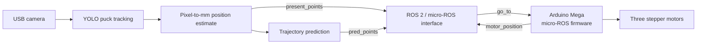

<div align="center">

# Air Hockey Robot

**A camera-guided air-hockey robot research project combining puck perception, trajectory prediction, ROS 
2 communication, and Arduino-based motion control.**


</div>

ffmpeg -i "video.mp4" -vf "fps=15,scale=560:-1:flags=lanczos" -loop 0 -q:v 55 walk.webp

> [!IMPORTANT]
> **This repository is currently ROS 2, not ROS 1.** The Python nodes use `rclpy`, the packages declare `ament_python`, and one Arduino sketch uses micro-ROS. The source has intentionally been preserved as requested; a ROS 1 / `catkin` runtime would require a ROS 1 port and is not provided here.

> [!WARNING]
> This is a hardware-control research snapshot, not a safety-certified product. Review the wiring, motor limits, serial transport, and emergency-stop arrangements before connecting motor power. Test with the mechanism safely restrained and at low speed.

## Contents

- [Project overview](#project-overview)
- [System architecture](#system-architecture)
- [Repository structure](#repository-structure)
- [ROS 2 interfaces](#ros-2-interfaces)
- [Hardware and software](#hardware-and-software)
- [Getting started](#getting-started)
- [Models and datasets](#models-and-datasets)
- [Demo recording](#demo-recording)
- [Known limitations](#known-limitations)
- [GitHub and large-file setup](#github-and-large-file-setup)
- [License](#license)

## Project overview

The project brings together a set of experimental components for detecting an air-hockey puck, estimating its position on the table, predicting its near-future trajectory, and commanding a three-motor mechanism. It includes ROS 2 Python package scaffolding, Arduino firmware experiments, image and trajectory datasets, trained model artifacts, and data-preparation scripts.

The repository is a **preserved development snapshot**: it contains multiple iterations and research outputs. The documented architecture reflects the interfaces visible in the source; it does not imply that every package, model path, or launch configuration is currently ready for a one-command deployment.

### What is included

| Area | Contents |
|---|---|
| Puck perception | YOLO/Ultralytics tracking configurations, detector weights, image data, and preprocessing tools |
| Position calibration | Scripts and artifacts for mapping image detections to table coordinates in millimetres |
| Trajectory prediction | LSTM-based experiments, trajectory CSV files, scalers, checkpoints, and plots |
| ROS 2 communication | `ament_python` packages and a launch-file draft |
| Motion control | Six Arduino sketches covering stepper timing, position, speed, and motion-profile experiments |
| Demo | The original screen recording, retained under [`media/`](media/) |

## System architecture

The intended data flow represented across the current source is:



The vision node in [`main_launching_unit.py`](src/yolo_pkg/yolo_pkg/codes/main_launching_unit.py) captures camera frames, tracks a puck, estimates position and velocity, and uses a trajectory model configured for 20 input samples and 30 predicted samples. The ROS 2 bridge consumes current/predicted puck data and motor position, then publishes target coordinates. The micro-ROS sketch subscribes to target coordinates and publishes the motor's estimated position.

The [`arduino_bridge`](src/arduino_bridge/) folder also contains a separate text-over-serial example ([`communication.py`](src/arduino_bridge/arduino_bridge/communication.py), using the `ros2ard` and `ard2ros` string topics). It is a distinct communication approach; the repository contains multiple experiments and does not establish that all serial/agent components should run together.

## Repository structure

```text
.
├── .gitattributes
├── .gitignore
├── README.md
├── media/
│   └── simplescreenrecorder-2025-09-06_14.00.29.mkv
└── src/
    ├── arduino_bridge/                # ROS 2 Python serial/command examples
    ├── motor_control/                 # Six standalone Arduino sketches
    └── yolo_pkg/
        ├── launch/                    # ROS 2 launch-file draft
        └── yolo_pkg/
            ├── codes/
            │   ├── data_collecting/   # Calibration and YOLO data tools
            │   ├── full_trajectory_prediction/
            │   ├── position_model/
            │   └── yolo_for_train/    # Dataset, runs, weights, configs
            └── images_source/         # Image sources and preprocessing tools
```

The existing source, model, and dataset hierarchy is intentionally retained because scripts refer to paths within it. [`motor_control`](src/motor_control/) is a collection of sketches, not a ROS package.

## ROS 2 interfaces

The main vision and bridge nodes use `std_msgs/msg/Float32MultiArray`. The payload layouts below are taken from the current callbacks and publishers; they are positional arrays rather than named, self-describing messages.

| Topic | Direction | Payload |
|---|---|---|
| `present_points` | Vision → bridge | `[frame, x_mm, y_mm, vx_mm_s, vy_mm_s]` |
| `pred_points` | Vision → bridge | Repeated `[frame, x_mm, y_mm]` triples |
| `motor_position` | Firmware → bridge | `[x_mm, y_mm]` |
| `go_to` | Bridge → firmware | `[target_x_mm, target_y_mm]` |

The micro-ROS firmware converts the `go_to` coordinates from millimetres to metres for its internal motion calculations and publishes its estimated position back in millimetres. Confirm the firmware version and topic layout before connecting a different sketch.

The separate text-serial example uses `std_msgs/msg/String`:

| Topic | Direction | Payload |
|---|---|---|
| `ros2ard` | ROS 2 → Arduino serial example | Command text |
| `ard2ros` | Arduino serial example → ROS 2 | Received text |

## Hardware and software

### Hardware indicated by the source

- Arduino Mega-class board (the motion sketches use ATmega2560 timer and port registers).
- Three stepper motors: one X-axis motor and two Y-axis motors.
- A compatible stepper-driver and power arrangement, selected and verified for the actual motors.
- USB camera; the current vision scripts request a 1280 × 720 stream and use camera index `2` with the Linux V4L2 backend.
- A Linux host for ROS 2 and the micro-ROS agent. The bridge defaults to serial device `/dev/ttyACM0` at `115200` baud.

The repository does not fully specify a bill of materials, motor-driver model, wiring diagram, table dimensions, or validated calibration procedure. Check the relevant sketch and hardware before use; do not assume that the six sketches share the same pinout or serial protocol.

### Software indicated by the source

- A ROS 2 distribution with `rclpy`, `std_msgs`, `launch`, and `launch_ros`; the package manifests use the `ament_python` build type.
- `colcon` and `rosdep` for ROS 2 workspace tooling.
- Python packages used across runtime and research scripts: OpenCV, NumPy, PyTorch, Ultralytics, Joblib, scikit-learn, pyserial, pandas, Matplotlib, PyYAML, and Pillow.
- Tkinter for the file-dialog based data-preparation scripts.
- Arduino tooling plus the micro-ROS Arduino library and a compatible micro-ROS agent for the micro-ROS sketch.

No dependency lockfile or tested version matrix is included. Select a PyTorch build compatible with the host's CPU/GPU and CUDA environment. The current ROS package manifests do not declare every Python runtime dependency.

## Getting started

### 1. Clone the repository and fetch its large files

Install [Git LFS](https://git-lfs.com/) before cloning, then:

```bash
git lfs install
git clone https://github.com/amuntu/air-hockey-robot.git
cd air-hockey-robot
git lfs pull
```

The `src/` workspace currently occupies approximately **524 MiB**, in addition to the approximately **40.6 MiB** demo recording. LFS bandwidth and storage quotas may apply.

### 2. Prepare a ROS 2 environment

On a Linux host with ROS 2 installed, source the setup file for the distribution you installed (the example below uses Humble):

```bash
source /opt/ros/humble/setup.bash
sudo apt install python3-colcon-common-extensions python3-rosdep
rosdep update
rosdep install --from-paths src --ignore-src --rosdistro "$ROS_DISTRO" -r -y
colcon build --symlink-install
source install/setup.bash
```

These are workspace preparation commands, not a verified end-to-end startup procedure. Because Python dependencies are incompletely declared, install the required computer-vision, ML, and serial packages separately in an environment compatible with your ROS 2 installation.

### 3. Validate the hardware integration before running

There is no verified one-command launch procedure in this snapshot. Before attempting hardware operation:

1. Select the intended Arduino sketch and verify its board, pin assignments, motor-driver settings, and ROS/serial transport.
2. Confirm the micro-ROS agent and firmware use the same ROS domain and message definitions.
3. Check that the selected camera index and serial device match the host.
4. Verify that every model and scaler path used by the vision node exists on the deployment machine.
5. Test ROS topics and motor motion with motor power safely disabled or the mechanism restrained.

See [Known limitations](#known-limitations) before treating the build or launch files as operational.

## Models and datasets

The repository retains both working data and experiment outputs:

- [`images_source/`](src/yolo_pkg/yolo_pkg/images_source/) — image-source and preprocessing scripts plus camera image collections.
- [`data_collecting/`](src/yolo_pkg/yolo_pkg/codes/data_collecting/) — scripts for collecting YOLO detections, merging detections with workspace calibration points, and plotting calibration points.
- [`yolo_for_train/`](src/yolo_pkg/yolo_pkg/codes/yolo_for_train/) — YOLO dataset files, training configurations, multiple training runs, model weights, and exported artifacts.
- [`position_model/`](src/yolo_pkg/yolo_pkg/codes/position_model/) — pixel-to-workspace position-model checkpoints, scalers, and training history.
- [`full_trajectory_prediction/`](src/yolo_pkg/yolo_pkg/codes/full_trajectory_prediction/) — trajectory CSV data, LSTM checkpoints/scalers, evaluation scripts, and plots.

Binary model formats include `.pt`, `.pth`, `.pkl`, and `.onnx`; training outputs also include image and archive files. The retained experiment data makes the repository large by design. Review the relevant model and dataset files before choosing which experiment to deploy.

## Demo recording

The original `.mkv` screen recording is included in [`media/simplescreenrecorder-2025-09-06_14.00.29.mkv`](media/simplescreenrecorder-2025-09-06_14.00.29.mkv). It is linked as a downloadable repository asset; GitHub README rendering should not be assumed to play this `.mkv` inline.

## Known limitations

This organization pass preserves the program files; it does not repair runtime behavior. The following issues should be resolved and validated before calling the project turnkey:

- **ROS version:** the Python packages use ROS 2 `rclpy` and `ament_python`; there is no ROS 1 `rospy`/Catkin implementation.
- **Console entry points:** [`src/yolo_pkg/setup.py`](src/yolo_pkg/setup.py) names `yolo_pkg.import_cv2_main_unit` and `yolo_pkg.ROS_Arduino_bridge`, but the corresponding scripts currently live under `yolo_pkg/codes/` with different module names.
- **Launch file:** [`launch_unit.py`](src/yolo_pkg/launch/launch_unit.py) contains machine-specific absolute paths in its `Node(package=...)` declarations.
- **Model/data paths:** multiple scripts use machine-specific `/home/...` or `/content/drive/...` paths. The vision node's expected checkpoint/scaler locations must be checked against the actual retained files.
- **Transport variants:** the repository contains a Python serial bridge, a string-based serial example, and a micro-ROS firmware path. Their intended deployment relationship and ownership of the serial device need to be established.
- **Dependencies and tests:** runtime dependencies are not fully declared or pinned, and the included package tests are mainly generated lint/test scaffolding rather than end-to-end robot tests.
- **License:** there is no root-level project license. The package metadata mentions Apache-2.0 for `yolo_pkg`, but its included `LICENSE` file is empty; this does not establish a license for the repository's other code, datasets, models, or recording.
- **Validation:** this repository organization has not been built or tested on a ROS 2 Linux host or on the physical robot.

These caveats are deliberately visible so that the repository does not promise ROS 1 compatibility or a reproducible hardware launch that the preserved source does not currently provide.
